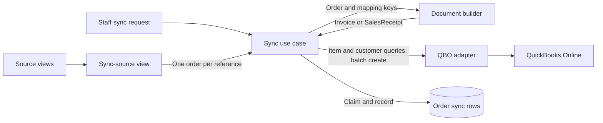
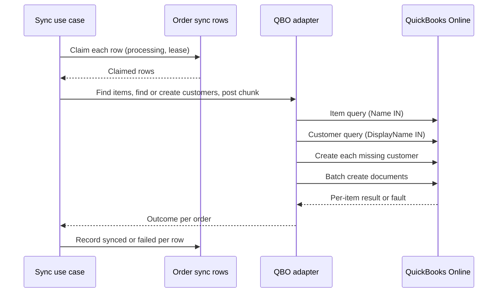

# QuickBooks Order Sync — Flow and Zap Parity

How M1 posts ShopWired orders to QuickBooks Online (QBO), and how each step of the Zapier flow it replaces carries over. M1 replicates the Zap almost exactly; every improvement beyond parity is a COR-321 point, undecided and not built (COR-294/D15).

- API contract: [`../api-contracts/quickbooks-order-sync.md`](../api-contracts/quickbooks-order-sync.md)
- Decisions: [ADR-0017](../adr/0017-qbo-order-sync-unit-and-post-once.md) (sync unit, post once), [ADR-0018](../adr/0018-qbo-mappings-hold-semantic-keys.md) (mapping keys), [ADR-0019](../adr/0019-qbo-m1-duplicate-safety-and-batch-document-create.md) (duplicate safety, batch create)

---

## Components

### Component flow

| Component | Responsibility |
|-----------|----------------|
| Source views | The synced ShopWired order, line and customer data the sync reads; never written by the sync |
| Sync-source view | Gives exactly one order per `reference`, through `shopwired.orders_deduplicated` |
| Document builder | An Application transformer over Domain tax and routing policy. Turns one order into an Invoice or SalesReceipt draft holding mapping keys, never QBO IDs (ADR-0018), or into a `skipped` (`cancelled`) or `failed` (`zero_lines`, `tax_rate_unsupported`) outcome; it owns the cancelled skip |
| Sync use case | Picks candidates, applies the stored-row rules, resolves the draft's mapping keys to the connected company's refs (COR-305), claims rows, calls the adapter per chunk and records each outcome |
| QBO adapter | Finds items by SKU, finds and creates customers, maps resolved drafts to QBO payloads, and posts each chunk's documents as one SDK batch call (ADR-0019). It resolves no mapping keys: the use case passes it resolved refs |

- An edited ShopWired order keeps its `reference` and the original row is cancelled. `shopwired.orders_deduplicated` picks the live row, and the cancelled skip is checked on that chosen row, so an edited order is not skipped for its cancelled original.
- A range request queues a run that walks the range in chunks; a reference request runs the same use case in the request. Both paths share the row-state rules in the contract doc.

---

## Claim, call, record

### Per-chunk sequence

- Claim, call and record are three separate steps. No database transaction wraps the QBO call: the claim commits before the call, and the record runs after it.
- The lease follows ADR-0012. A row whose lease is still live is `in_progress` to any other worker; an expired lease lets a later run attempt the row again.
- A post can reach QBO and go unrecorded (a lost batch response, or a worker dying between call and record). The row then reads `failed` with `outcome_unknown`, or stays `processing` until its lease expires. A re-attempt can post the document again; recovery is COR-321 points 2 and 3 (ADR-0019).

---

## Zap parity table

Each Zap rule is described in words. Classes:

- `parity`: M1 behaves as the Zap does.
- `user-approved deviation`: M1 differs, by an explicit decision.
- `replacement mechanism`: M1 reaches the same result by a different mechanism, set by the cited decision.
- `COR-321 point`: a difference deferred to COR-321, undecided.

| Zap step | Zap rule | M1 behaviour | Class | Reference |
|----------|----------|--------------|-------|-----------|
| Trigger | Runs once per new ShopWired order | Staff trigger a range run or a reference sync from ADM; nothing runs on new orders | `replacement mechanism` | COR-294/D20 |
| Trigger | No status filter: a cancelled order is posted | A cancelled order is skipped with reason `cancelled` | `user-approved deviation` | COR-294/D18 |
| Trigger | An edited order fires the Zap again and can post a second document | The post-once sync row, unique on (`realm_id`, `reference`), returns `already_synced`; the live row comes from `orders_deduplicated` | `replacement mechanism` | COR-294/D20, ADR-0017 |
| Run history | Each run is recorded by Zapier; nothing stops a second post | The post-once sync row records each reference's posted document | `replacement mechanism` | COR-294/D20, ADR-0017 |
| Error replay | A failed run is replayed from Zapier's run history | A failed order is a `failed` row in `GET /api/quickbooks/orders/failed`, re-attempted with `force_retry` | `replacement mechanism` | COR-294/D20 |
| Notification | A chat message is sent per posted document | No per-document notification | `replacement mechanism` | COR-294/D20 |
| Path split | Payment method picks the invoice path (substring match) or the sales-receipt path | Same split on the same payment methods | `parity` | COR-294/D21 |
| Path split | Methods that reach neither path (credit, empty) post nothing; `Offline` takes the invoice path | An order with an empty method already fails ShopWired order ingest, so it never reaches the sync | `parity` | COR-294/D21, COR-294/D22 |
| Credit orders | A credit order reaches neither path and posts nothing | A credit order posts an invoice, with no payment key | `user-approved deviation` | COR-303 AC1, COR-321 |
| Deposit and payment refs | A later step matches the method against an exact, case-sensitive list, so some sales-receipt orders get empty deposit and payment refs | Same: those orders post with empty refs | `parity` | COR-294/D21; fix is COR-321 point 12 |
| Customer find | One `DisplayName =` find per order | One `DisplayName IN (…)` query per chunk over its distinct names, matched back case-insensitively; QBO compares `=` and `IN` the same way | `replacement mechanism` | COR-294 plan D1, ADR-0019 |
| Customer create | A miss creates the customer with one call | Same: one create call per miss; a duplicate-name fault re-queries that name | `parity` | COR-294/D19 |
| Customer race | Two overlapping runs can both miss and create the same customer | Same race between overlapping runs | `parity` | COR-294 plan D14; serialising is COR-321 point 14 |
| DisplayName shape | Invoice: company name, else the customer's name. Sales receipt: the same name with the postcode appended | Same shapes | `parity` | COR-294/D21 |
| Name cleaning | Strips only the first `:` and the first `;` from the name | Same: first occurrence only | `parity` | COR-294/D21 |
| Name escaping | An apostrophe-escape step runs, but its output is never used | No equivalent behaviour; the customer query escapes `'` itself (ADR-0019) | `parity` | COR-294/D21 |
| Invoice terms | The customer's sales term, else a fixed default term | Same | `parity` | COR-294/D21 |
| Addresses | Invoice and sales-receipt address shapes differ | Same two shapes | `parity` | COR-294/D21 |
| Tax code | Chosen by rate (20 or 0). Only a zero-rated line to the delivery country exactly "Ireland" gets its own code; a rate-20 Ireland line keeps the standard code | Same: a zero-rated Ireland goods line takes `eu_goods` and zero-rated Ireland shipping takes `eu_shipping`; a rate-20 Ireland line stays `standard`. The "Ireland" match is exact and case-sensitive | `parity` | COR-294/D21; fix is COR-321 point 13 |
| Item lookup | Item found by SKU; a miss halts the Zap for that order | A miss fails the order with reason `item_missing` | `parity` | COR-294/D21 |
| VAT rounding chain | Lines are tax-excluded and QBO computes VAT. Multiplier = (100 + integer rate) / 100, or 1 below a rate of 1. Net unit price = (price + VAT per unit) / multiplier, rounded half away from zero to 7 dp. Line amount = net unit price × quantity, to 2 dp; when a second rounding helper disagrees, the net unit price itself is rounded to 2 dp | Same chain in exact decimals. The Zap's 0.0001 nudge and 2 dp fallback never fire under exact decimals, so dropping them changes representation, not behaviour | `parity` | COR-294/D16, COR-295 D9 and D16 |
| Shipping line amount | Passes the pre-discount shipping total (`original_shipping_total_net`) to Zapier's QBO action, tax-excluded with a 20 or 0 shipping tax code; zero-rated shipping to the delivery country exactly "Ireland" takes its own shipping code, distinct from the goods code | Posts the post-discount `shipping_total_net`, tax-excluded with the same 20 or 0 shipping tax key, and `eu_shipping` for zero-rated shipping to "Ireland" (COR-303 D3). COR-295 owns and builds the shipping line | `user-approved deviation` | COR-295 D8 |
| Shipping line rounding | No Zap step rounds the shipping total, and how Zapier's action rounds the line is not visible | Rounds the shipping line to 2 dp half-up, with .5 away from zero. COR-295 owns and builds the shipping line. Closed | `user-approved deviation` | COR-294 plan D4, COR-295 D16 (COR-295 plan D10) |

No row is quoted from the Zap export, and no QBO ID or code appears here: every QBO ref is a mapping key (ADR-0018).
